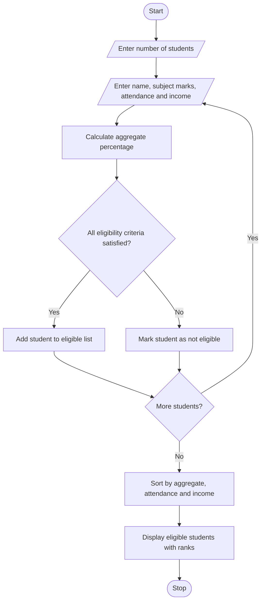

# Problem Statement
Develop a Python program to allocate university scholarships based on students’ aggregate marks, subject-wise minimum marks, attendance percentage, and family income. The program should identify eligible students, rank them according to their aggregate marks, and resolve ties using predefined rules.
# Assumptions
1. Students must score at least 75% aggregate marks.
2. Each subject must have a minimum of 60 marks out of 100.
3. Attendance must be at least 75%.
4. Annual family income must not exceed ₹2,50,000.
5. Eligible students are ranked by aggregate marks in descending order.
6. If aggregate marks are equal, higher attendance gets priority. If attendance is also equal, lower family income gets priority.
7. The program displays eligible students in rank order.
# Algorithm
1. Start the program.
2. Enter the number of students.
3. Input each student's name, subject marks, attendance, and annual family income.
4. Calculate aggregate marks as a percentage.
5. Check all scholarship eligibility conditions.
6. Store eligible students in a list.
7. Sort eligible students by aggregate marks, attendance, and family income using the predefined tie-breaking rules.
8. Display the eligible students with their ranks.
9. Stop the program.
# Mermaid Flowchart

# Pseudocode
START

INPUT number_of_students
CREATE empty eligible_list

FOR each student:
    INPUT name
    INPUT marks in all subjects
    INPUT attendance
    INPUT annual_family_income

    CALCULATE aggregate_percentage

    IF aggregate_percentage >= 75 AND
       every subject mark >= 60 AND
       attendance >= 75 AND
       income <= 250000 THEN

        ADD student to eligible_list
    END IF
END FOR

SORT eligible_list BY:
    aggregate marks in descending order
    attendance in descending order
    family income in ascending order

DISPLAY ranked eligible students

STOP

# Python Source Code
students = []n = int(input("Enter number of students: "))for i in range(n):    print("\nStudent", i + 1)    name = input("Enter student name: ")    marks = []    for j in range(1, 6):        mark = int(input(f"Enter marks in subject {j}: "))        marks.append(mark)    attendance = float(input("Enter attendance percentage: "))    income = int(input("Enter annual family income: "))    aggregate = sum(marks) / len(marks)    if (aggregate >= 75 and min(marks) >= 60            and attendance >= 75 and income <= 250000):        students.append({            "name": name,            "aggregate": aggregate,            "attendance": attendance,            "income": income        })students.sort(key=lambda s: (    -s["aggregate"], -s["attendance"], s["income"]))print("\n--- SCHOLARSHIP ELIGIBLE STUDENTS ---")if students:    for rank, s in enumerate(students, start=1):        print(            rank, s["name"],            "| Aggregate:", round(s["aggregate"], 2),            "| Attendance:", s["attendance"],            "| Income:", s["income"]        )else:    print("No eligible students found.")

# Sample Output
For example, suppose four students apply. Their details are entered as follows.
Student	Subject marks (5 subjects)	Attendance	Annual income
Asha	80, 78, 85, 90, 82	90%	₹2,00,000
Ravi	80, 78, 85, 90, 82	90%	₹1,80,000
Priya	75, 72, 80, 78, 75	88%	₹2,20,000
Kiran	90, 55, 80, 85, 90	95%	₹1,50,000

The resulting output is:
--- SCHOLARSHIP ELIGIBLE STUDENTS ---
1 Ravi | Aggregate: 83.0 | Attendance: 90.0 | Income: 180000
2 Asha | Aggregate: 83.0 | Attendance: 90.0 | Income: 200000
3 Priya | Aggregate: 76.0 | Attendance: 88.0 | Income: 220000

Kiran is not eligible because one subject mark is below 60. Ravi ranks above Asha because both have equal aggregate marks and attendance, but Ravi has lower family income.

# Conclusion
The program evaluates scholarship applicants based on aggregate marks, subject-wise minimum marks, attendance, and family income. It ranks eligible students and resolves ties using attendance and family income criteria.
