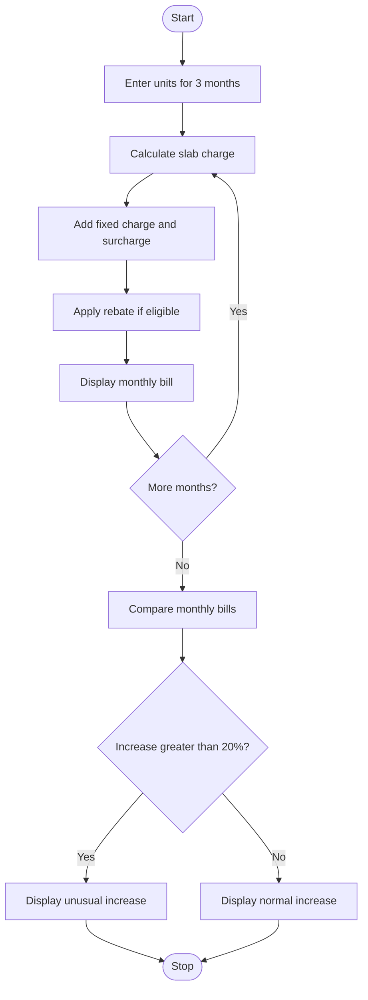

# Problem Statement
Develop a simple Python program to calculate electricity bills based on units consumed. The program applies different rates for different consumption slabs, adds fixed charges and surcharges, gives a rebate when applicable, and compares monthly bills to identify unusual increases.
# Assumptions
- First 100 units: ₹2 per unit.
- Next 100 units: ₹3 per unit.
- Units above 200: ₹5 per unit.
- Fixed charge: ₹50.
- Surcharge: 5% of the slab bill.
- Rebate: ₹20 if consumption is below 100 units.
- An increase of more than 20% from the previous month's bill is considered unusual.
These are sample rates for this assignment, not official electricity tariffs.
# Algorithm
1. Start.
2. Enter electricity units for three months.
3. Calculate the slab charge for each month.
4. Add the fixed charge.
5. Calculate and add the surcharge.
6. Apply the rebate if eligible.
7. Display each month's bill.
8. Compare each bill with the previous month's bill.
9. Display a warning if the bill increases by more than 20%.
10. Stop.
# Mermaid Flowchart

5. Pseudocode
START
INPUT electricity units for each month

FOR each month:
    Calculate slab charge
    Add fixed charge
    Calculate surcharge
    Apply rebate if units < 100
    Calculate final bill
    DISPLAY final bill

FOR each month after the first:
    Calculate percentage increase
    IF increase > 20%:
        DISPLAY "Unusual increase"
    ELSE:
        DISPLAY "Normal increase"

STOP

# Python Source Code

def calculate_bill(units):
    if units <= 100:
        charge = units * 2
    elif units <= 200:
        charge = 100 * 2 + (units - 100) * 3
    else:
        charge = 100 * 2 + 100 * 3 + (units - 200) * 5

    fixed = 50
    surcharge = charge * 0.05
    rebate = 20 if units < 100 else 0

    total = charge + fixed + surcharge - rebate
    return total

bills = []

for month in range(1, 4):
    units = int(input("Enter units for month " + str(month) + ": "))
    bill = calculate_bill(units)
    bills.append(bill)
    print("Month", month, "Bill: Rs.", round(bill, 2))

for i in range(1, 3):
    increase = (bills[i] - bills[i - 1]) / bills[i - 1] * 100

    if increase > 20:
        print("Month", i + 1, ": Unusual increase")
    else:
        print("Month", i + 1, ": Normal increase")

# Sample Output
Enter units for month 1: 80
Month 1 Bill: Rs. 198.0
Enter units for month 2: 120
Month 2 Bill: Rs. 270.0
Enter units for month 3: 250
Month 3 Bill: Rs. 837.5
Month 2 : Unusual increase
Month 3 : Unusual increase

# Result
The program calculates electricity bills using progressive consumption slabs, fixed charges, surcharges, and rebates. It compares bills across three months and identifies increases greater than 20%.
